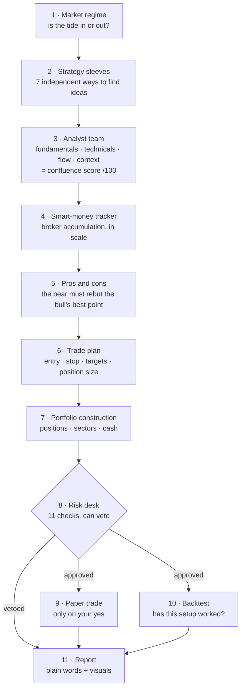

<div align="center">


# NEPSE Trading Desk

**An AI research desk for Nepal's stock market.**<br/>
Eleven specialists, one plain-language report you can actually understand, built on live NEPSE data.

Works in **Claude, ChatGPT, Gemini, Claude Code, Cursor** and any app that speaks MCP.

[](LICENSE)
[](skills/nepse-trading-desk/SKILL.md)
[](https://stockyan.com/features/nepse-ai-connector/)

[Install](#install-in-one-click) · [What you get](#what-you-get) · [How the desk works](#how-the-desk-works) · [Try it](#try-these) · [नेपालीमा](README.ne.md)

</div>

> **Research, not investment advice.** The desk never tells you to buy or sell, never places real orders, and every
> number it shows comes from live StockYan data with its date. Paper trades happen only when you say yes.

## Why

Ask a plain chatbot "what NEPSE stock should I buy?" and you get a confident paragraph built on old or invented
numbers. Professional desks don't work like that. They check the market's mood first, look for ideas in several
independent ways, have specialists score each one, argue the case against it, plan the exit before the entry, size
the position so one bad day can't hurt much, and only then write it up.

**NEPSE Trading Desk gives your AI that whole process**, adapted to Nepal: the 15% daily price band, thin liquidity,
broker floorsheet data, book closures, right shares and lock-in expiries.

## What you get

Ask *"What should I buy this week?"* and the desk answers with cards like this (layout example):

```
NABIL · Nabil Bank                                   data to 18 Nov 2026
🟡 Mixed · Confidence ●●○ medium · Desk score 66/100

Fundamentals  ▰▰▰▰▰▰▰▰▱▱  20/25  earning more than last year, cheaper than peers
Technicals    ▰▰▰▰▰▰▱▱▱▱  15/25  uptrend, but momentum fading at resistance
Smart money   ▰▰▰▰▰▰▰▱▱▱  18/25  four brokers steadily buying for a month
Context       ▰▰▰▰▱▱▱▱▱▱  13/25  market breadth weak, banks flat

Rs 581  ─── Target 2 (52-week high)
Rs 553  ─── Target 1 (resistance)
Rs 550  ◀── now
Rs 532  ─── Entry zone (support)
Rs 518  ─── Stop: the idea is wrong below here

With Rs 5 lakh: about 120 shares (capped for a 15% gap day). If the stop is hit you lose about Rs 1,700.
Risk desk: ✅ regime ✅ liquidity ⚠️ reward/risk 1.5 to target 1: better entry on a pullback
```

Every term is explained in plain words the first time it appears. On apps that can draw diagrams, the desk adds one.

## How the desk works



| Station | What it does |
|---|---|
| 1 · [Market regime](skills/nepse-trading-desk/references/desks/01-market-regime.md) | NEPSE vs its 200-day average sets how much of the account should be invested at all (🟢 80-100% … 🔴 0-20%). |
| 2 · [Strategy sleeves](skills/nepse-trading-desk/references/desks/02-strategy-sleeves.md) | Trend breakout, pullback, oversold bounce, momentum, smart money, value, squeeze, plus events. Ideas found by two sleeves rank higher. |
| 3 · [Analyst team](skills/nepse-trading-desk/references/desks/03-analyst-team.md) | Four analysts score 0-25 each; the total is the confluence score. |
| 4 · [Smart money](skills/nepse-trading-desk/references/desks/04-smart-money.md) | NEPSE publishes broker numbers on every trade. The desk reads accumulation over weeks, in scale against volume, without claiming manipulation. |
| 5 · [Pros and cons](skills/nepse-trading-desk/references/desks/05-debate.md) | Why it could work, why it could fail, and the one fact that would flip the verdict. |
| 6 · [Trade plan](skills/nepse-trading-desk/references/desks/06-trade-plan.md) | Entry zone, stop (support or 2×ATR), targets, reward/risk ≥ 2, and size: 1% risk, capped so a 15% one-day fall costs ≤ 2% and the position is ≤ 10% of daily turnover. |
| 7 · [Portfolio](skills/nepse-trading-desk/references/desks/07-portfolio.md) | 5-10 positions, ≤ 30% per sector, ≥ 15% cash, no strategy above 40%. |
| 8 · [Risk desk](skills/nepse-trading-desk/references/desks/08-risk-desk.md) | Regime, reward/risk, liquidity, gap risk, events, broker selling, thin-float flags, chasing. Can veto. |
| 9 · [Paper trade](skills/nepse-trading-desk/references/desks/09-paper-execution.md) | Rehearse in StockYan's paper account, with a journal entry and price alerts on your phone. |
| 10 · [Backtest](skills/nepse-trading-desk/references/desks/10-backtest.md) | Replays the strategy over NEPSE history with StockYan's backtester: trades, win rate, return after costs, how often it beat NEPSE. |
| 11 · [Report](skills/nepse-trading-desk/references/report-design.md) | Answer card, analyst bars, price ladder, risk checks, sources and dates. |

## Install in one click

**Claude, ChatGPT and Gemini apps: add the connector. That's it.**
The StockYan connector carries the whole desk method, so there's nothing else to install.

| App | How |
|---|---|
| Claude (web, desktop, phone) | [**Add to Claude**](https://claude.ai/customize/connectors?modal=add-custom-connector&connectorName=StockYan&connectorUrl=https%3A%2F%2Fstockyan.astrixel.com%2Fmcp) → Add → sign in to StockYan → Allow |
| ChatGPT | chatgpt.com/plugins → **+** → Add custom MCP server → `https://stockyan.astrixel.com/mcp` |
| Gemini, Perplexity, Le Chat | Add a custom connector with `https://stockyan.astrixel.com/mcp` ([guide](https://stockyan.com/learn/stockyan-claude-chatgpt-mcp/)) |

**Claude Code: one command** (installs the skill and the connector together):

```bash
claude plugin install nepse-trading-desk --marketplace AstrixelHQ/nepse-trading-desk
```

or inside Claude Code: `/plugin marketplace add AstrixelHQ/nepse-trading-desk` then
`/plugin install nepse-trading-desk@nepse-trading-desk`. Type `/mcp` once to sign in to StockYan.

**Gemini CLI**

```bash
gemini extensions install https://github.com/AstrixelHQ/nepse-trading-desk
```

**Cursor, Codex and other agents**

```bash
npx skills add AstrixelHQ/nepse-trading-desk
```

then add the connector `https://stockyan.astrixel.com/mcp` in your agent's MCP settings.

You need a StockYan account. The free plan covers market data, stock pages, broker activity, your portfolio and paper
trading; scanners and the backtester need StockYan Pro or Max, and the desk works around anything locked.

## Try these

```
What should I buy this week?
Is NABIL worth buying now? Make me a plan with Rs 2 lakh.
Find hydropower stocks breaking out with brokers buying.
Does buying oversold banks actually work? Backtest it.
Review my portfolio. Am I too concentrated?
Put that trade in my paper account and alert me at the stop.
NEPSE aaja kasto bhayo?
```

## What it will and won't do

- ✅ Reads live StockYan data; dates every number; says "not available" instead of guessing.
- ✅ Explains every term in plain words; shows the downside in rupees first.
- ✅ Changes your StockYan account (paper trades, journal, alerts, watchlists) only after you say yes.
- ❌ Never places real orders, applies for IPOs or sees your MeroShare password.
- ❌ Never says "buy" or "sell" as an instruction, and never promises returns.

## For developers

```
skills/nepse-trading-desk/
├── SKILL.md                    the desk: rules, modes, stations
└── references/
    ├── desks/01-…10-*.md        one playbook per station
    ├── report-design.md         answer card, bars, ladder, glossary
    ├── nepse-basics.md          trading rules, costs, tax
    └── portfolio-review.md · market-brief.md · investor-lenses.md
evals/test-cases.md             behaviour checks
scripts/validate.py             checks the skill and manifests (CI)
scripts/export-playbooks.py     copies the playbooks into the StockYan connector
```

The connector serves the same playbooks through `get_desk_playbook`, so an improvement here reaches every app.
Issues and pull requests are welcome, especially new strategy sleeves with backtest evidence.

## Links

[StockYan](https://stockyan.com) · [Connector guide](https://stockyan.com/learn/stockyan-claude-chatgpt-mcp/) ·
[Privacy](https://stockyan.com/privacy/) · [Terms](https://stockyan.com/terms/) · support@stockyan.com

Inspired by the research-team designs of [TradingAgents](https://github.com/TauricResearch/TradingAgents) and
[ai-hedge-fund](https://github.com/virattt/ai-hedge-fund), multi-manager risk practice, and the skill format of
[anthropics/skills](https://github.com/anthropics/skills).

MIT © Investo Nepal Pvt. Ltd.
