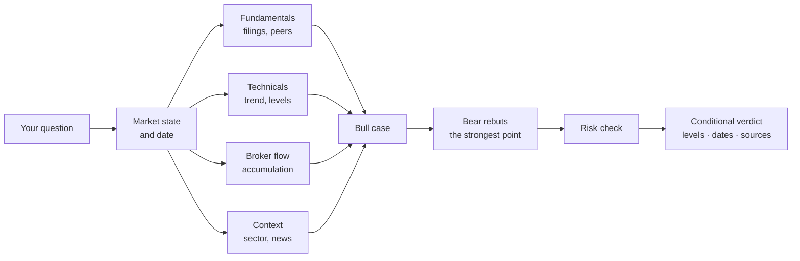

<div align="center">


# StockYan Research

**Research the Nepal Stock Exchange (NEPSE) like a professional analyst, inside Claude, ChatGPT, Gemini and more.**

An open-source [Agent Skill](https://agentskills.io) that teaches your AI *how* to research NEPSE stocks,
and the [StockYan connector](https://stockyan.com/features/nepse-ai-connector/) that gives it live data:
prices, company filings, broker buying and selling, technical and fundamental scanners, and your own portfolio.

[](LICENSE)
[](skills/stockyan-research/SKILL.md)
[](https://stockyan.com/learn/stockyan-claude-chatgpt-mcp/)

[Install](#install) · [Try it](#try-these) · [Example report](examples/nabil-deep-dive.md) · [How it works](#how-it-works) · [नेपालीमा](README.ne.md)

</div>

> **Research, not investment advice.** This skill helps you look at evidence. It never tells you to buy or sell,
> never places real orders, and every number it shows comes from live StockYan data with its date.

## Why

Ask a plain AI "is NABIL a good buy?" and you get a confident answer built on old or invented numbers. Connect it
to StockYan and it has the data, but still no method: one tool call, one shallow paragraph.

This skill adds the method. Your AI works like a small research team:

1. **Four analysts gather evidence:** fundamentals, technicals, broker flow and context (sector, news, events).
2. **A bull makes the case, and a bear rebuts its strongest point.**
3. **A risk check:** liquidity, the 15% daily price band, book closures, lock-in expiries, your concentration.
4. **A conditional verdict:** which way the evidence leans, how strongly, and the levels and dates that would prove it
   wrong. Every number dated, every source named.

Broker flow is NEPSE's edge: the exchange publishes which broker bought from which on every trade. The skill reads it
carefully, in scale against total volume and over weeks rather than days, without claiming manipulation.

## Install

You need a StockYan account (free works; some tools need Pro or Max) and an AI app that supports MCP connectors.

<details open>
<summary><b>Claude Code</b></summary>

```
/plugin marketplace add AstrixelHQ/stockyan-skills
/plugin install stockyan-research@stockyan
```

This installs the skill and the StockYan connector together. Type `/mcp`, choose **stockyan** and sign in.
</details>

<details>
<summary><b>Claude (web, desktop, phone)</b></summary>

1. Add the connector: [one-click link](https://claude.ai/customize/connectors?modal=add-custom-connector&connectorName=StockYan&connectorUrl=https%3A%2F%2Fstockyan.astrixel.com%2Fmcp), or Customize → Connectors → Add custom connector → `https://stockyan.astrixel.com/mcp`.
2. Add the skill: download `stockyan-research.zip` from [Releases](https://github.com/AstrixelHQ/stockyan-skills/releases/latest), then upload it under Skills in Claude's settings (Customize → Skills).
</details>

<details>
<summary><b>ChatGPT</b></summary>

Install the StockYan app from the ChatGPT app directory once it's listed: it carries this skill. Until then, add
`https://stockyan.astrixel.com/mcp` as a custom MCP server (chatgpt.com/plugins → + → Add custom MCP server).
</details>

<details>
<summary><b>Gemini CLI</b></summary>

```
gemini extensions install https://github.com/AstrixelHQ/stockyan-skills
```
</details>

<details>
<summary><b>Codex, Cursor and other agents</b></summary>

```
npx skills add AstrixelHQ/stockyan-skills
```

Then add the connector `https://stockyan.astrixel.com/mcp` in your agent's MCP settings.
</details>

## Try these

```
Is NABIL worth buying now?
Find 3 hydropower stocks that are cheap against peers and seeing broker buying.
Review my StockYan portfolio. What needs a look?
Who has been buying UPPER this month, and is it meaningful?
How did NEPSE do today?
What would a Buffett-style investor think of NICA?
NEPSE aaja kasto bhayo?
```

See a full real answer: [Is NABIL worth buying now? (18 Nov 2026)](examples/nabil-deep-dive.md).

## How it works



| Playbook | For |
|---|---|
| [Stock deep dive](skills/stockyan-research/references/stock-deep-dive.md) | "Tell me about X", "is X a good buy?" |
| [Idea finder](skills/stockyan-research/references/idea-finder.md) | "Which stocks look good?", screens that overlap |
| [Portfolio review](skills/stockyan-research/references/portfolio-review.md) | Concentration, broken trends, tax timing, events |
| [Broker flow](skills/stockyan-research/references/broker-flow.md) | Floorsheet, big trades, "smart money", read with care |
| [Market brief](skills/stockyan-research/references/market-brief.md) | The day or week in five lines |
| [Investor lenses](skills/stockyan-research/references/investor-lenses.md) | Buffett, Graham and Lynch-style checklists (stylised) |
| [NEPSE basics](skills/stockyan-research/references/nepse-basics.md) | Trading days, bands, tax, EPS quirks, units |

## What it will and won't do

- It reads live StockYan data and changes your StockYan account (watchlists, alerts, notes, paper trades) **only when
  you ask**, and confirms before deleting anything.
- It can't place real trades, apply for IPOs or see your MeroShare password.
- It labels uncertainty, and says "not available" instead of guessing.

## Testing

`evals/test-cases.md` lists behaviour checks (method, safety, language). `python3 scripts/validate.py` checks the skill
and manifests; it runs on every push.

## Links

[StockYan](https://stockyan.com) · [Connector setup guide](https://stockyan.com/learn/stockyan-claude-chatgpt-mcp/) ·
[Privacy](https://stockyan.com/privacy/) · [Terms](https://stockyan.com/terms/) · support@stockyan.com

Inspired by the research-team designs of [TradingAgents](https://github.com/TauricResearch/TradingAgents) and
[ai-hedge-fund](https://github.com/virattt/ai-hedge-fund), and the skill format of [anthropics/skills](https://github.com/anthropics/skills).

MIT © Investo Nepal Pvt. Ltd.
