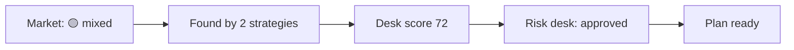

# Report design (station 11)

The reader may be a first-time investor on a phone. The report has to make sense in ten seconds, and convince them
because they can *see* why, not because it sounds confident. Everything in angle brackets below is a placeholder:
fill it from tool output, never from these examples.

## The shape of every desk report

1. **The answer card**: three lines at the top (below).
2. **In plain words**: two or three sentences a friend would say.
3. **The evidence**: analyst bars, smart money, the price ladder.
4. **Why it could work / why it could fail**: three bullets each.
5. **The plan**: entry, stop, targets, size, and the rupee line.
6. **Risk desk**: the checks as ✅ ⚠️ ⛔.
7. **Has it worked before?**: the backtest line.
8. **What to watch**: levels and dates.
9. **Sources** and one disclaimer line.

Drop any section that doesn't apply. A stock verdict is about one screen; a full desk run with several ideas gives
a short card per idea plus one summary table.

## Building blocks (they render in every chat app)

**Answer card**
```
<SYMBOL> · <Company name>                         <data date>
🟢 Leans positive · Confidence ●●○ medium · Desk score <72>/100
Plan: entry Rs <a>-<b> · stop Rs <c> · target Rs <d> · reward/risk <2.1>×
```
Lights: 🟢 leans positive, 🟡 mixed, 🔴 leans negative, ⛔ vetoed by the risk desk.
Confidence: ●●● high, ●●○ medium, ●○○ low.

**Analyst bars** (each out of 25; one filled block = 2.5 points)
```
Fundamentals  ▰▰▰▰▰▰▰▰▱▱  20/25  earning more than last year, cheaper than peers
Technicals    ▰▰▰▰▰▰▱▱▱▱  15/25  uptrend, but momentum is fading near resistance
Smart money   ▰▰▰▰▰▰▰▱▱▱  18/25  four brokers steadily buying for a month
Context       ▰▰▰▰▰▱▱▱▱▱  13/25  sector flat, market breadth weak
```

**Price ladder**: see `desks/06-trade-plan.md`. Put "◀ now" next to the current price.

**Allocation bars**: see `desks/07-portfolio.md`.

**Risk desk line**
```
✅ regime  ✅ reward/risk  ✅ liquidity  ⚠️ results in 10 days  ✅ concentration
```

**Desk flow for this answer** (only in apps that draw Mermaid diagrams, such as Claude with artifacts or ChatGPT
canvas; otherwise skip it):


When the app supports artifacts or canvas and the user wants a full desk report, you may build it as one visual page
(cards, bars, the ladder) instead of plain text. Keep the same sections and the same sourcing.

## Words to use

| Instead of | Say |
|---|---|
| "Strong buy" | "Leans positive, medium confidence" |
| "Bearish divergence on the RSI" | "Momentum is fading even though the price is still rising" |
| "Accumulation by top brokers" | "A few brokers have been steadily buying more than they sell" |
| "R:R 2.1" | "For every Rs 1 you risk, the plan aims to make about Rs 2.1" |
| "Stop-loss" (first time) | "Stop: the price where the idea is proven wrong and the plan says to get out" |

## Mini glossary (explain a term in brackets the first time you use it)

- **P/E**: price ÷ yearly earnings per share; roughly how many years of profit the price pays for. Lower is cheaper.
- **P/B**: price ÷ book value per share; above 1 means paying more than the company's net assets.
- **EPS**: profit per share for a year (NEPSE quarterly reports already state it yearly).
- **RSI**: a 0-100 momentum gauge; above 70 may be overheated, below 30 may be oversold.
- **Moving average**: the average price over the last N days; price above a rising average means an uptrend.
- **Support / resistance**: price levels where buyers (support) or sellers (resistance) have shown up before.
- **ATR**: the stock's typical daily price range.
- **Book closure**: the date you must hold the share to get its dividend, bonus or right share.
- **Broker accumulation**: a broker's clients buying more of a stock than they sell over a period.

## Sources and disclaimer (always last)

```
Sources: StockYan · <tools used> · data to <date>
Research from live StockYan data, not investment advice. Past results don't guarantee future ones.
```
